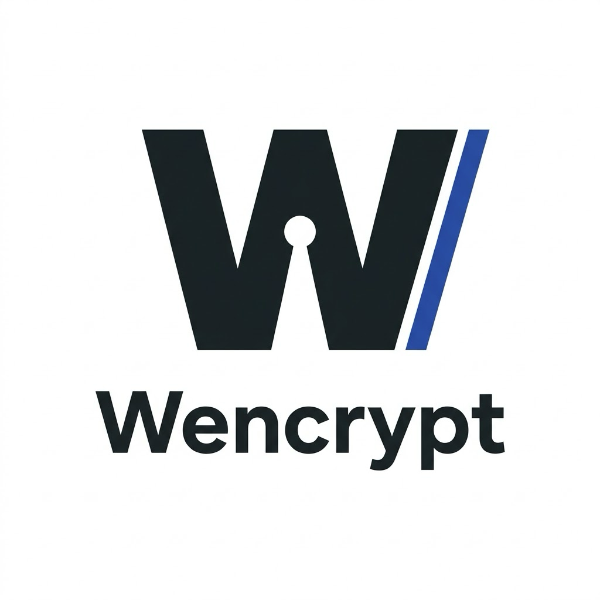
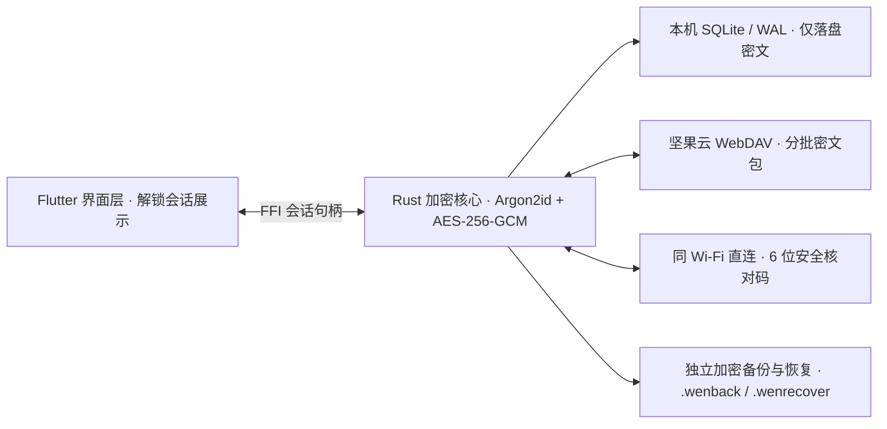

<div align="center">



# Wencrypt

**离线优先、端到端加密的跨平台个人密码管理器**

把密码留在自己手里 —— 无需第三方云账号，无遥测上报，基于 Rust 加密核心与 Flutter 原生体验

[](https://github.com/WendelYu/Wencrypt/releases/latest)
[](https://github.com/WendelYu/Wencrypt/actions/workflows/ci.yml)
[](#下载与安装)
[](#面向开发者)
[](https://github.com/WendelYu/Wencrypt/releases)

[为什么选择 Wencrypt](#为什么选择-wencrypt) · [核心功能](#核心功能) · [安全与隐私](#安全与隐私) · [下载与安装](#下载与安装) · [快速上手](#快速上手) · [项目现状](#项目现状) · [面向开发者](#面向开发者)

</div>

---

## 为什么选择 Wencrypt

大多数密码管理器要么依赖闭源云服务，要么在跨设备同步和日常录入上繁琐费力。**Wencrypt** 希望在「数据完全自主」与「日常顺手好用」之间找到平衡：

| 特性 | 说明 |
| :--- | :--- |
| **完全离线优先** | 密码库以密文保存在本机，不依赖任何自建云或第三方密码服务器，无账号体系、无遥测上报。 |
| **同步方式自己掌控** | 支持通过你自己的 **坚果云 WebDAV** 跨设备加密同步，也支持 **同 Wi-Fi 端到端直连** 与 **独立加密备份**。 |
| **录入高效顺手** | 支持 **本机离线截图 OCR 识别** 账号密码、浏览器 CSV 一键迁移，以及实时熵值密码生成器。 |
| **三端一致体验** | macOS、Windows、Android 共享同一套 Rust 加密与同步核心，桌面与移动端均针对屏幕尺寸独立适配。 |

---

## 核心功能

### 密码库管理与高效录入

- **清晰好用的日常管理**：支持本地新增、实时搜索、自定义分组、置顶、密码强度提示、回收站恢复/批量清理以及单条历史版本追溯。
  - **桌面端**：宽屏双栏详情检视面板 + 键盘命令面板（`⌘K` / `Ctrl+K`）。
  - **Android 端**：原生风格的 4 Tab 底部导航与移动端详情面板。
- **截图快捷导入（100% 本地离线 OCR）**：支持剪贴板粘贴（`⌘V` / `Ctrl+V`）、选择图片文件，以及 Android 系统「分享图片到 Wencrypt」。调用系统本地引擎（macOS Apple Vision / Windows WinRT OCR / Android ML Kit）离线提取账号、密码、网址与服务名并自动预填，**图片永不上传网络**。
- **随机密码生成器**：基于密码学安全随机源（`Random.secure()`），支持 8–64 位自定义长度（默认 20 位）、大小写/数字/符号组合、排除易混淆字符，并实时显示密码熵值。
- **浏览器迁移与单条分享导出**：
  - 桌面端支持导入 **Chrome、Edge、Firefox** 导出的 CSV，提供「仅选新增」筛选、相同凭据自动合并与记住本机监听目录。
  - 单条账号可导出为**文字**或**图片**（默认隐藏密码，可按需勾选）；文字三端复制至剪贴板，图片在桌面端复制至剪贴板、在 Android 保存到相册。

### 跨设备同步与无痛加机

- **坚果云 WebDAV 加密同步**：
  - 采用分批密文包增量传输，支持断点续传与免费坚果云流量预算控制。
  - 并发修改不同账号自动合并，同一账号并发修改保留双版本冲突提示，绝不静默覆盖；本机加密记录每次同步详情。
  - 每台设备可独立设置 **「手动」「仅提醒」** 或 **「自动同步」**（自动模式空闲时自动拉长检查间隔）。
- **多种新设备接入方式**：
  - **离线加密邀请**：原设备生成二维码或加密邀请码，新设备只需输入 **1 次主密码** 即可自动完成同步配置；Android 内置基于 CameraX + ZXing Core 的离线「扫一扫加入」（支持相册识图）。
  - **同 Wi-Fi 加密直连**：核对 6 位安全核对码后，局域网端到端加密传输密码库与同步配置。
  - **坚果云邀请链接 / 加密备份恢复**：灵活满足换机、重装与多端部署。

### 应用内安全更新

- 内置「关于与更新」检查 GitHub Releases 新版本（支持自动检查开关），下载后**强制校验 `SHA256SUMS.txt`**。
- **macOS & Windows**：支持应用内一键下载、校验、覆盖并自动重启。
- **Android**：支持应用内检查更新并跳转下载正式签名包。

---

## 安全与隐私

Wencrypt 的所有加解密、密钥派生与密文存储均收敛在 Rust 核心层完成，云端与传输通道全程仅接触密文：



- **现代密码学原语**：采用 **Argon2id + AES-256-GCM**，每个修订对象使用独立随机盐（HKDF-SHA-256 派生子密钥）与 12 字节随机 Nonce；本机 SQLite 与 WAL 仅落盘密文，密钥材料保留在 Rust 会话中并在锁定时清理。
- **生物识别与主动防护**：
  - macOS（Touch ID）与 Android（指纹）支持本机生物识别解锁及授权导出备份（每 72 小时复验一次主密码）。
  - 后台/失焦及 5 分钟闲置自动锁定；复制密码后 20 秒若剪贴板未变化自动清除；Android 启用 `FLAG_SECURE` 防截屏并关闭系统自动备份。
- **完整的密码生命周期**：
  - 支持随时**修改主密码**，其他已加入设备在同步检测到更新后会自动提示验证新主密码。
  - 支持导出独立加密备份（`.wenback`）以及提前创建**主密码恢复文件**（`.wenrecover`），与恢复密钥分开保管即可在忘记主密码时重置。

---

## 下载与安装

前往 [**GitHub Releases**](https://github.com/WendelYu/Wencrypt/releases/latest) 下载对应平台安装包。自 `v0.3.11` 起，全平台应用名与安装包统一命名为 `Wencrypt-v<版本>-*`，每次发布均附带 `SHA256SUMS.txt` 供校验完整性。

| 平台 | 系统与架构要求 | 安装包文件名 | 生物识别解锁 | 应用内自动更新 |
| :--- | :--- | :--- | :---: | :---: |
| **macOS** | Apple Silicon（macOS 13.0+） | `Wencrypt-v*-macos-arm64.dmg` | Touch ID | 自动下载更新并重启 |
| **Windows** | x64 | `Wencrypt-v*-windows-x64.zip` | 主密码 | 自动下载更新并重启 |
| **Android** | ARM64（Android 10 / API 29+） | `Wencrypt-v*-android-arm64.apk` | 指纹 | 检查更新并跳转下载 |

<details>
<summary><strong>macOS 安装说明与首次打开提示（点击展开）</strong></summary>

1. 下载 `-macos-arm64.dmg`，将 `Wencrypt.app` 拖入「应用程序」文件夹后打开。
2. 当前版本尚未经过 Apple 公证，首次启动若提示「无法验证开发者」或「已损坏」，请查看 DMG 内的 `首次打开帮助.html` 或参考 [Apple 官方首次打开说明](https://support.apple.com/zh-cn/102445)；在核对 `SHA256SUMS.txt` 无误后，也可在终端运行：
   ```sh
   xattr -dr com.apple.quarantine "/Applications/Wencrypt.app"
   ```
3. 手动拖入安装 `v0.3.10` 及以上版本一次后，后续可在应用内「关于与更新」静默挂载 DMG 自动更新并重启。
4. 从 `v0.3.9` 及更早沙盒版本升级时，首次启动会自动将原沙盒容器中的密码库与 Touch ID 元数据无损迁移至 `~/Library/Application Support/org.wencrypt.wencrypt`。

</details>

<details>
<summary><strong>Windows 安装与数据目录说明（点击展开）</strong></summary>

1. 下载 `-windows-x64.zip`，完整解压至任意目录后运行 `Wencrypt.exe`。
2. 密码库保存在当前 Windows 用户的 `%APPDATA%\org.wencrypt\Wencrypt`（Windows 路径不区分大小写，旧版数据目录会自动沿用）。
3. 后续可在「关于与更新」内直接下载校验并自动替换重启，也可直接下载新版解压覆盖。

</details>

<details>
<summary><strong>Android 安装与旧版签名迁移说明（点击展开）</strong></summary>

1. 下载 `-android-arm64.apk` 安装即可。自 `v0.3.7` 起使用固定正式签名，后续正式版可直接覆盖升级。
2. 若当前仍在使用早期开发签名包（`-android-arm64-debug.apk` 或 `v0.3.6` 及更早版本），卸载前请务必先导出并验证 `.wenback` 加密备份，完整步骤见 [Android 从旧开发签名迁移](docs/08-alpha-guide.md#android-从旧开发签名迁移)。

</details>

---

## 快速上手

1. **创建你的第一个密码库**：在第一台设备选择「创建新库」，设置至少 12 位主密码；如需跨设备同步，在「坚果云设置」绑定一个同步目录并完成首次同步。
2. **接入其他设备**：在新设备选择「加入已有库」，按场景任选一种方式：
   - **扫码 / 离线邀请码**：原设备生成二维码或加密邀请码，新设备输入主密码即可自动配好同步。
   - **同 Wi-Fi 加密直连**：核对 6 位安全码，局域网端到端传输密码库。
   - **坚果云加入 / 备份恢复**：输入同一同步目录与 WebDAV 应用密码，或导入 `.wenback` 加密备份恢复。
3. **提前做好安全兜底**：建议在「设置 → 安全 → 创建主密码恢复文件」生成 `.wenrecover` 并与恢复密钥**分开存放**，并定期留存离线 `.wenback` 备份。

> [!TIP]
> 从 `0.3.0` 之前版本升级的用户，请先将所有设备升级到最新版本，再在资料最完整的设备上完成一轮同步。新版以分批密文包同步，保留旧历史与回收站状态，并移除了旧版 598 条修订限制。更多细节请查阅 [使用与升级说明](docs/08-alpha-guide.md)。

### 桌面端快捷键

| 快捷键（macOS / Windows） | 功能 |
| :--- | :--- |
| `⌘K` / `Ctrl+K` | 打开命令面板 |
| `⌘F` / `Ctrl+F` | 聚焦密码库搜索 |
| `⌘N` / `Ctrl+N` | 新建账号 |
| `⌘V` / `Ctrl+V` | 在「从截图快捷导入」弹窗中粘贴剪贴板图片并识别 |

---

## 项目现状

> [!WARNING]
> **透明说明**：Wencrypt 目前处于 **Public Alpha 活跃迭代阶段**，尚未完成独立的第三方密码学与安全审计。如果你计划存放极高价值的账号密码，请结合独立离线加密备份审慎评估。

- **已完成与已验证**：三端核心加密、SQLite 密文存储、分批密文包同步、离线截图 OCR、局域网/离线设备邀请、应用内校验更新均已落地，并通过模拟 WebDAV 的多库大批量同步测试及各端自动化单元测试。
- **持续推进中**：真实坚果云环境与三端全矩阵实机验收仍在进行；macOS 公证流程、系统自动填充（Autofill）、自定义字段编辑、词组密码生成器及更多同步适配器将在后续阶段推进。

---

## 面向开发者

### 技术栈与目录结构

- **加密核心**：Rust（1.85+）— `argon2`、`aes-gcm`、`hkdf`、`sha2`、`zeroize`、`rusqlite`
- **客户端界面**：Flutter（Dart SDK `^3.14.0`）+ 各平台原生桥接（Swift / C++ WinRT / Kotlin）

```text
Wencrypt/
├── crates/
│   ├── wencrypt-core/       # Rust 加密核心、SQLite 密文存储、同步协议与 C ABI / FFI
│   └── wencrypt-probe/      # 加密与同步验证探针
├── apps/
│   └── wencrypt_flutter/    # macOS / Windows / Android Flutter 客户端与原生桥接
├── tools/                   # 跨平台打包脚本 (package_p0.py)、签名与探针工具
├── test-vectors/            # WENC v1 测试向量与 CBOR CDDL 定义
└── docs/                    # 架构、加密格式、同步协议与发布文档
```

<details>
<summary><strong>本地测试与打包命令（点击展开）</strong></summary>

```sh
# 1. 运行 Rust 核心测试
cargo test --workspace

# 2. 运行 Flutter 静态分析与单元测试
cd apps/wencrypt_flutter && flutter analyze && flutter test

# 3. 打包各平台安装包（产物输出至 build/p0/）
python3 tools/package_p0.py macos
python3 tools/package_p0.py windows
python3 tools/package_p0.py android --android-release
```

</details>

### 延伸文档

| 文档 | 内容说明 |
| :--- | :--- |
| [使用与升级说明](docs/08-alpha-guide.md) | 完整上手流程、Android 签名迁移、免费坚果云流量预算与排错 |
| [架构设计](docs/02-architecture.md) | 模块边界、技术栈选型与设备保护等级说明 |
| [加密格式（WENC v1）](docs/03-crypto-format.md) | 密钥层次、二进制封装、CBOR 结构与安全性质 |
| [同步协议](docs/04-sync-protocol.md) | 密文包同步、版本图与冲突保留机制 |
| [坚果云配置与自动发布](docs/07-jianguoyun-and-github.md) | WebDAV 配置、CI 构建与 GitHub Release 发布说明 |
| [实测记录](reports/p0-status.md) | 阶段性验证状态与实测数据 |
